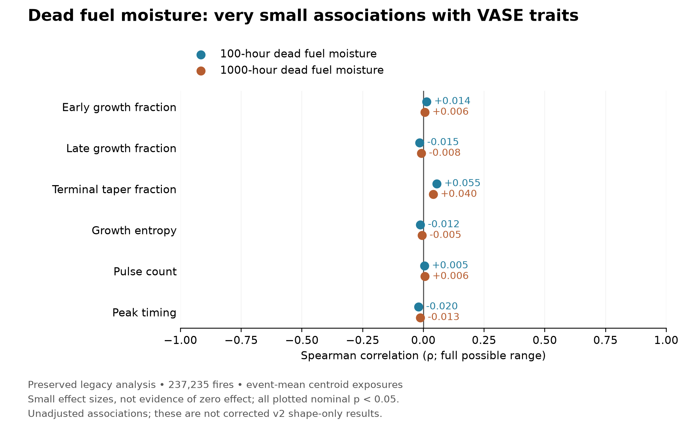

# Exploratory dead fuel moisture plot

Reproduce with `.venv/bin/python scripts/plot_fuel_moisture_associations.py`.
The script reads the preserved summary table
`analysis/climate_revision_stats/climate_response_spearman_effects.csv`
and exports PNG and SVG to `figures/exploratory/`.

These are unadjusted event-mean centroid associations for 237,235 fires,
using 100-hour and 1000-hour **dead**, not live, fuel moisture. Six legacy
developmental traits are shown; absolute area/duration and legacy PCA are
excluded, and the duplicate reactivation-count result is omitted.
The plotted correlations have absolute magnitude below 0.056. All have
nominal p < 0.05, so this is a small-effect result, not a statistical null.
No confidence intervals are available in this source table.

These summaries predate corrected v2; see
`analysis/v2/legacy_dependency_audit.md` for limitations of legacy feature
construction and exposures. In particular, the old claim that comprehensive
predictors failed to improve on core predictors came from non-nested model
sets and should not be used as evidence of no incremental fuel effect.
This figure does not establish absence of an independent fuel effect and
does not substitute for a corrected v2 fuel-specific analysis.
